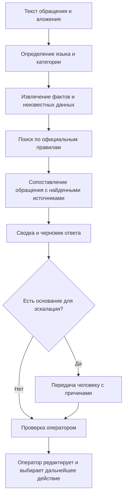

# Support Copilot by Grand Mobile

**Ассистент оператора поддержки и анализа обращений игроков**  
**Decentrathon 6.0 · Команда ZHS · Версия 1.0 · 30 октября 2026 года**

> Support Copilot превращает свободный текст жалобы в структурированную карточку для оператора: определяет предполагаемую категорию, выделяет утверждения игрока и недостающие сведения, находит относящиеся к делу положения официальных правил и готовит черновик ответа на языке обращения. Система помогает принять обоснованное решение, но не подменяет сотрудника поддержки.

##КРАТКО

| Параметр | Описание |
|---|---|
| Продукт | Рабочее место оператора поддержки Grand Mobile |
| Пользователь | Оператор или специалист службы поддержки |
| Проблема | Жалобы поступают в свободной форме; факты, доказательства и применимые правила приходится искать вручную |
| Решение | Единый конвейер классификации, извлечения сведений, поиска правил, подготовки ответа и эскалации |
| Результат работы | Структурированная карточка обращения с источниками, неизвестными данными, черновиком ответа и причинами ручной проверки |
| Принцип безопасности | AI рекомендует и объясняет; окончательное решение принимает человек |
| Границы MVP | Не устанавливает виновность, не назначает и не снимает санкции, не обещает возврат имущества и не отправляет ответы автоматически |

**Ключевая идея:** не универсальный чат-бот, а проверяемый помощник оператора, у которого каждое утверждение отделено от доказательства, а каждая рекомендация по правилам должна вести к конкретному источнику.

## 1. Проблема и ценность

Оператору необходимо прочитать обращение, понять его тип, выделить существенные сведения, проверить приложенные материалы, найти подходящие положения правил и подготовить корректный ответ. При ручной обработке эти шаги занимают время и создают риск пропустить важную деталь или сослаться не на тот пункт.

Support Copilot собирает эти действия в одном рабочем процессе. Он помогает:

- быстрее распределять обращения по категориям и приоритетам;
- видеть, что именно утверждает игрок, какие материалы приложены и что подтверждено системой;
- замечать отсутствующие сведения и формировать уточняющие вопросы;
- находить выдержки из базы правил с названием документа и ссылкой на источник;
- готовить редактируемый ответ на языке обращения;
- передавать неоднозначные и чувствительные случаи специалисту с понятным объяснением причины.

Ценность продукта — не в автоматическом наказании игрока, а в повышении последовательности, проверяемости и скорости работы поддержки.

## 2. Как работает продукт



### Этапы обработки

1. **Приём.** Система получает текст, язык обращения, идентификатор тикета и сведения о вложениях.
2. **Классификация.** Предлагает категорию и приоритет. При недостатке контекста выбирает `other` и запрашивает уточнение.
3. **Извлечение.** Выделяет участников, события, даты, сервер, аккаунт или персонажа, желаемый результат и приложенные материалы.
4. **Разделение данных.** Маркирует сведения как утверждения игрока, предоставленные материалы, подтверждённые системные данные или неизвестные обстоятельства.
5. **Поиск правил.** Ищет релевантные фрагменты в подготовленной базе официальных источников.
6. **Проверка источников.** Для каждого найденного положения сохраняет документ, номер пункта, точную выдержку, URL и дату/версию источника. Если подтверждённого фрагмента нет, система сообщает об этом вместо выдуманной ссылки.
7. **Подготовка ответа.** Формирует краткую сводку, недостающие вопросы и черновик на языке игрока.
8. **Эскалация и решение.** При наличии критичного условия показывает причины ручной проверки. Оператор проверяет результат и сам выбирает дальнейшее действие.

## 3. Что получает оператор

Результат анализа — структурированная карточка обращения. Основные поля:

| Поле | Назначение |
|---|---|
| `ticket_id` | Идентификатор обращения |
| `language` | Определённый язык: `ru`, `kk`, `uz` или `other` |
| `category` | Предварительная категория обращения |
| `priority` | Предложенный приоритет: `low`, `normal`, `high`, `urgent` |
| `summary` | Краткое содержание обращения |
| `player_claims` | Утверждения игрока, не представленные как установленные факты |
| `provided_evidence` | Перечень приложенных материалов и доступных сведений о них |
| `verified_data` | Только данные, подтверждённые подключённой системой или проверкой оператора |
| `unknowns` | Существенные обстоятельства, которые пока неизвестны |
| `missing_information_questions` | Вопросы, необходимые для дальнейшего рассмотрения |
| `rule_references` | Подтверждённые ссылки на положения официальных документов |
| `analysis` | Объяснение связи обращения с найденными материалами |
| `draft_reply` | Черновик ответа на языке игрока |
| `human_review_required` | Признак необходимости ручной проверки |
| `escalation_reasons` | Конкретные причины передачи специалисту |
| `confidence` | Оценка уверенности модели в результате, от `0` до `1` |

**Важное различие:** слова игрока — это `player_claims`, файл от игрока — это `provided_evidence`, а не автоматически доказанное нарушение. В `verified_data` попадают только действительно подтверждённые сведения. Наличие видео или скриншота само по себе не доказывает нарушение.

## 4. Категории обращений MVP

| Категория | Типичные случаи | Что важно выяснить |
|---|---|---|
| `appeal_ban` | Обжалование бана или другой санкции | Сервер, ник/ID, вид и дата санкции, её причина, номер обращения |
| `player_report` | Жалоба на игрока: предполагаемые читы, оскорбления, мошенничество | Ник/ID, сервер, дата и время, описание события, доступные доказательства |
| `admin_complaint` | Жалоба на действия администратора | Имя/идентификатор администратора, дата, номер обращения или санкции, суть претензии |
| `account_security` | Потеря доступа, предполагаемый взлом или кража имущества | Безопасные сведения об аккаунте, примерное время события, описание изменений |
| `payment` | Платёж или неполученная покупка | Данные операции, дата и подтверждение платежа; нужны официальные материалы по платежам |
| `bug` | Техническая ошибка | Сервер, устройство/версия клиента, шаги воспроизведения, время и материалы ошибки |
| `other` | Неясное или нестандартное обращение | Уточняющий вопрос без преждевременного выбора правила |

Категория и приоритет являются рекомендациями системы и могут быть исправлены оператором.

## 5. Официальные источники правил

Для прототипа собран реестр публичных материалов Grand Mobile Help Center. Он является исходной базой для проверки, но **не гарантирует полноту внутренних регламентов**. Перед использованием в реальной поддержке содержание и актуальность необходимо сверить с разделом «Правила» в лаунчере и с организаторами/представителями проекта.

Основные источники:

- [Коллекция «Нарушения и санкции»](https://support.grnd.gg/ru/collections/12404105-%D0%BD%D0%B0%D1%80%D1%83%D1%88%D0%B5%D0%BD%D0%B8%D1%8F-%D0%B8-%D1%81%D0%B0%D0%BD%D0%BA%D1%86%D0%B8%D0%B8) — подборка материалов о нарушениях и санкциях.
- [I. Общие положения проекта](https://support.grnd.gg/ru/articles/12974291-i-%D0%BE%D0%B1%D1%89%D0%B8%D0%B5-%D0%BF%D0%BE%D0%BB%D0%BE%D0%B6%D0%B5%D0%BD%D0%B8%D1%8F-%D0%BF%D1%80%D0%BE%D0%B5%D0%BA%D1%82%D0%B0).
- [II. Правила общения и использования чатов](https://support.grnd.gg/ru/articles/12974295-ii-%D0%BF%D1%80%D0%B0%D0%B2%D0%B8%D0%BB%D0%B0-%D0%BE%D0%B1%D1%89%D0%B5%D0%BD%D0%B8%D1%8F-%D0%B8-%D0%B8%D1%81%D0%BF%D0%BE%D0%BB%D1%8C%D0%B7%D0%B0%D0%BD%D0%B8%D1%8F-%D1%87%D0%B0%D1%82%D0%BE%D0%B2).
- [III. Взаимодействие с администрацией](https://support.grnd.gg/ru/articles/12974298-iii-%D0%BF%D1%80%D0%B0%D0%B2%D0%B8%D0%BB%D0%B0-%D0%B2%D0%B7%D0%B0%D0%B8%D0%BC%D0%BE%D0%B4%D0%B5%D0%B9%D1%81%D1%82%D0%B2%D0%B8%D1%8F-%D1%81-%D0%B0%D0%B4%D0%BC%D0%B8%D0%BD%D0%B8%D1%81%D1%82%D1%80%D0%B0%D1%86%D0%B8%D0%B5%D0%B9-%D1%81%D0%B5%D1%80%D0%B2%D0%B5%D1%80%D0%B0).
- [IV. Правила использования игровых аккаунтов и персонажей](https://support.grnd.gg/ru/articles/12974300-iv-%D0%BF%D1%80%D0%B0%D0%B2%D0%B8%D0%BB%D0%B0-%D0%BF%D0%BE%D0%BB%D1%8C%D0%B7%D0%BE%D0%B2%D0%B0%D0%BD%D0%B8%D1%8F-%D0%B8%D0%B3%D1%80%D0%BE%D0%B2%D1%8B%D0%BC%D0%B8-%D0%B0%D0%BA%D0%BA%D0%B0%D1%83%D0%BD%D1%82%D0%B0%D0%BC%D0%B8-%D0%B8-%D0%BF%D0%B5%D1%80%D1%81%D0%BE%D0%BD%D0%B0%D0%B6%D0%B0%D0%BC).
- [V. Правила игрового процесса](https://support.grnd.gg/ru/articles/12974302-v-%D0%BF%D1%80%D0%B0%D0%B2%D0%B8%D0%BB%D0%B0-%D0%B8%D0%B3%D1%80%D0%BE%D0%B2%D0%BE%D0%B3%D0%BE-%D0%BF%D1%80%D0%BE%D1%86%D0%B5%D1%81%D1%81%D0%B0).
- [Жалобы на игроков](https://support.grnd.gg/ru/articles/11071798-%D0%B6%D0%B0%D0%BB%D0%BE%D0%B1%D1%8B-%D0%BD%D0%B0-%D0%B8%D0%B3%D1%80%D0%BE%D0%BA%D0%BE%D0%B2) и [как подать жалобу на нарушение правил](https://support.grnd.gg/ru/articles/11071809-%D0%BA%D0%B0%D0%BA-%D0%BF%D0%BE%D0%B4%D0%B0%D1%82%D1%8C-%D0%B6%D0%B0%D0%BB%D0%BE%D0%B1%D1%83-%D0%BD%D0%B0-%D0%BD%D0%B0%D1%80%D1%83%D1%88%D0%B5%D0%BD%D0%B8%D0%B5-%D0%BF%D1%80%D0%B0%D0%B2%D0%B8%D0%BB-%D0%B4%D1%80%D1%83%D0%B3%D0%B8%D0%BC-%D0%B8%D0%B3%D1%80%D0%BE%D0%BA%D0%BE%D0%BC).
- [Обжалование санкций](https://support.grnd.gg/ru/articles/11071819-%D0%BE%D0%B1%D0%B6%D0%B0%D0%BB%D0%BE%D0%B2%D0%B0%D0%BD%D0%B8%D0%B5-%D1%81%D0%B0%D0%BD%D0%BA%D1%86%D0%B8%D0%B9) и [процесс подачи апелляции](https://support.grnd.gg/ru/articles/11071824-%D0%BF%D1%80%D0%BE%D1%86%D0%B5%D1%81%D1%81-%D0%BF%D0%BE%D0%B4%D0%B0%D1%87%D0%B8-%D0%B0%D0%BF%D0%B5%D0%BB%D0%BB%D1%8F%D1%86%D0%B8%D0%B8-%D0%BD%D0%B0-%D0%BD%D0%B0%D0%BB%D0%BE%D0%B6%D0%B5%D0%BD%D0%BD%D1%8B%D0%B5-%D1%81%D0%B0%D0%BD%D0%BA%D1%86%D0%B8%D0%B8).
- [Где найти полный список правил в лаунчере](https://support.grnd.gg/ru/articles/12802933-%D0%B3%D0%B4%D0%B5-%D1%8F-%D0%BC%D0%BE%D0%B3%D1%83-%D0%BE%D0%B7%D0%BD%D0%B0%D0%BA%D0%BE%D0%BC%D0%B8%D1%82%D1%8C%D1%81%D1%8F-%D1%81-%D0%BF%D1%80%D0%B0%D0%B2%D0%B8%D0%BB%D0%B0%D0%BC%D0%B8-%D0%BF%D1%80%D0%BE%D0%B5%D0%BA%D1%82%D0%B0).

### Требования к ссылкам на правила

Рекомендация по правилу считается подтверждённой только при наличии:

- названия исходного документа;
- точного номера пункта, если он присутствует в источнике;
- точной выдержки без изменения смысла;
- прямого URL на источник;
- даты получения или версии источника.

Если подходящий пункт не найден, источник недоступен, устарел или противоречит другому материалу, система должна явно показать ограничение и предложить ручную проверку. Нельзя подставлять придуманные номера пунктов или формулировки.

## 6. Когда система передаёт обращение человеку

Эскалация обязательна, если выполняется хотя бы одно из условий:

- Игрок оспаривает Ban, Warn, Mute или Jail, а для рассмотрения нужны логи, доказательства или проверка решения администратора.
- Есть обвинение в мошенничестве, краже, взломе, читерстве или злоупотреблении, но нет достаточных проверяемых материалов.
- Обращение содержит угрозы, доксинг, дискриминацию, сексуальное насилие или другую потенциально опасную ситуацию.
- В официальных источниках нет нужного положения, источники противоречат друг другу или их актуальность не подтверждена.
- Не хватает критичных сведений: сервера, ника/ID, даты и времени, номера санкции/обращения или подтверждения платежа.
- Уверенность модели ниже порога, который будет установлен по результатам тестирования.
- Ответ потребовал бы признать игрока виновным, назначить или снять наказание либо гарантировать возврат имущества или компенсацию.

В карточке недостаточно показать только `human_review_required: true`. Оператору должны быть видны конкретные `escalation_reasons` и сведения, которых не хватает для проверки.

## 7. Демонстрационный сценарий

**Пример: жалоба на предполагаемое использование читов.**

Входящее сообщение: «Игрок использует стороннюю программу».

Ожидаемая работа Support Copilot:

1. Предварительно классифицировать обращение как `player_report`.
2. Зафиксировать использование сторонней программы как утверждение заявителя, а не как установленный факт.
3. Указать, какие сведения нужны: сервер, ник/ID игрока, дата и время события, описание поведения и доступные видео/скриншоты.
4. Найти подходящие фрагменты раздела правил игрового процесса только при наличии точных подтверждённых выдержек.
5. Показать ссылки на документы и отдельно отметить ограничения доказательств.
6. Подготовить нейтральный черновик ответа на языке обращения.
7. Передать обращение на ручную проверку, поскольку обвинение требует проверки материалов и игровых данных.

**Критерий успешного результата:** система не объявляет игрока нарушителем, не назначает блокировку и не отправляет ответ самостоятельно. Она помогает оператору увидеть, что известно, что ещё нужно проверить и на какие источники можно опереться.

## 8. Проверка качества и критерии приёмки

Для оценки MVP предусмотрены шесть тестовых типов обращений: апелляция на бан, оскорбления в чате, жалоба на администратора, предполагаемый взлом, сообщение о читах и неясная жалоба.

Ключевые метрики:

| Метрика | Что проверяется |
|---|---|
| Точность классификации | Насколько корректно выбрана категория обращения |
| Качество извлечения фактов | Не перепутаны ли утверждения игрока, материалы, проверенные данные и неизвестные сведения |
| Точность ссылок на правила | Соответствуют ли номер, выдержка и URL реальному источнику |
| Полнота эскалации | Не пропущены ли случаи, где обязательно нужен человек |
| Качество черновика | Соответствуют ли язык, тон и содержание контексту обращения |
| Время обработки | Сокращается ли время подготовки обращения оператором |

Численные показатели качества не заявляются до проведения тестирования. Порог уверенности и метрики должны быть установлены на тестовом наборе, а не выбраны произвольно.

MVP принимается, если на сквозном сценарии показаны классификация, извлечение фактов, подтверждённый поиск правил, черновик ответа и объяснимая эскалация; оператор может исправить результат; неподтверждённые ссылки и автоматические санкции отсутствуют.

## 9. Технологии и структура проекта

По текущей структуре репозитория проект разделён на frontend и Python-часть:

- **Frontend:** TypeScript/TSX, Vite; страницы, компоненты, контекст состояния и стили находятся в `src/`.
- **Backend:** Python-модули находятся в `app/`; среди видимых файлов — `main.py`, `database.py`, `models.py` и каталог `ai_engine/`.
- **Тесты:** каталог `tests/`.
- **Зависимости и конфигурация:** `package.json`, `package-lock.json`, `requirements.txt`, `vite.config.ts`, файлы TypeScript-конфигурации.

Основные frontend-разделы по структуре репозитория:

```text
src/
├── components/     # общие компоненты интерфейса
├── context/        # состояние и контекст приложения
├── lib/            # вспомогательные функции
├── pages/          # страницы продукта
├── App.tsx         # корневой компонент приложения
├── main.tsx        # точка входа frontend
├── styles.css      # глобальные стили
└── types.ts        # типы данных

app/
├── ai_engine/      # AI-логика
├── database.py     # работа с данными
├── main.py         # точка входа backend
└── models.py       # модели данных

tests/              # тесты
```

Точный способ запуска backend, используемый AI-провайдер, схема базы данных и параметры окружения следует сверять с фактической конфигурацией проекта. README не фиксирует неподтверждённые названия моделей, сервисов или API.

### Запуск frontend

В корне проекта установите зависимости и используйте команду разработки, указанную в `scripts` файла `package.json`:

```bash
npm install
npm run dev
```

Перед запуском backend установите Python-зависимости из `requirements.txt`. Команду запуска backend и необходимые переменные окружения следует брать из фактической конфигурации `app/main.py` и настроек проекта.

## 10. Команда

| Роль | Зона ответственности |
|---|---|
| Аналитик | Категории обращений, требования, реестр правил, структура фактов, сценарии тестирования и проверка результатов |
| Разработчик 1 — Backend | API, хранение тикетов, загрузка базы правил, схема данных и интеграция интерфейса с AI |
| Разработчик 2 — AI | Классификация, извлечение фактов, поиск по правилам, черновики ответов, уверенность и условия эскалации |
| Дизайнер | Список обращений, рабочая карточка, различение утверждений и доказательств, редактор ответа и состояния ручной проверки |

## 11. Ограничения и следующие шаги

Текущая аналитическая спецификация подготовлена, но несколько вопросов требуют подтверждения до промышленного использования:

1. **Полнота правил.** Публичный Help Center может не содержать всех внутриигровых правил и внутренних регламентов поддержки. Нужна сверка с лаунчером и представителями проекта.
2. **Версии источников.** Для каждого документа необходимо сохранять дату получения и историю изменений. В аналитических материалах отмечены разные даты публикации разделов и статей; их актуальность следует проверять при загрузке.
3. **Реальные данные.** Наличие обезличенных тикетов, шаблонов ответов, истории решений и API со стороны партнёра не подтверждено.
4. **Вложения.** Полученный файл не равен подтверждённому доказательству. Автоматическая интерпретация содержимого видео и изображений не должна заявляться без реализации и отдельного тестирования.
5. **Языки.** Поддержку русского, казахского и узбекского необходимо проверить на примерах и оценить с участием носителей языка.
6. **Платежи.** Категория `payment` требует отдельного набора официальных инструкций и безопасного порядка работы с платёжными данными.
7. **Метрики.** Точность классификации, цитирования и эскалации должна быть измерена на размеченной выборке; до этого нельзя указывать неподтверждённые проценты качества.

Приоритет ближайшей работы: подтвердить актуальные источники правил, получить тестовые данные, прогнать сценарии T1–T6, измерить качество, уточнить порог эскалации и зафиксировать проверенные команды запуска и настройки окружения.

## 12. Итог

Support Copilot — это инструмент поддержки принятия решений для операторов Grand Mobile. Он структурирует жалобу, отделяет утверждения от подтверждённых данных, показывает недостающую информацию, связывает рекомендации с официальными источниками и подготавливает редактируемый ответ. В сложных, опасных или недостаточно подтверждённых случаях он явно передаёт решение человеку.

**Главный результат MVP — не автоматическое решение по игроку, а более быстрый, прозрачный и проверяемый процесс рассмотрения обращения.**
